# Manual de uso para Acreditación

Este manual es para las personas de Acreditación que publican y mantienen el contenido del Sistema de Autoevaluación de la Universidad de los Llanos. No necesita saber Drupal. El manual le habla de «usted» y cada tarea va en pasos numerados.

Las capturas son del sitio local de pruebas, en pantalla de computador (1440 px) y, en tres, de celular (390 px). Las imágenes de los carruseles son de prueba: Acreditación debe subir las reales.

## 1. Entrar y moverse por el sitio

### Entrar

El sitio no tiene un botón público de acceso. Se entra por una dirección propia:

1. Abra `/acceso-acreditacion` en el navegador, después del nombre del sitio.
2. Escriba su **Nombre de usuario** y su **Contraseña**.
3. Pulse **Iniciar sesión**. El sitio lo lleva a la portada.

Las cuentas las crea la persona administradora; no hay registro abierto. Si olvidó su clave o no tiene cuenta, pídala a quien administra el sitio.

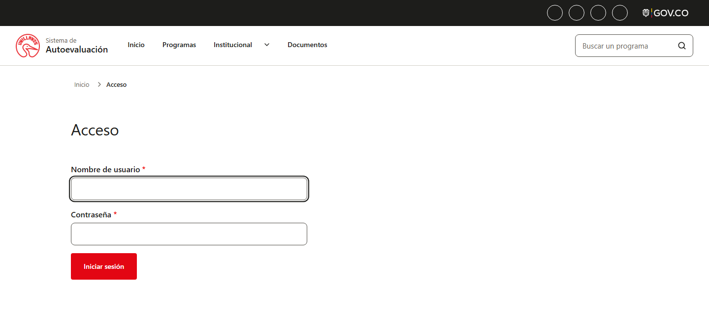

### El sitio público de un vistazo

Antes de editar conviene conocer lo que ve el público.

- **La portada (`/`)** es el portal de Autoevaluación y Acreditación: un carrusel, los accesos a Programas académicos, Institucional y Documentos, el acceso al SIAAI y las tres noticias más recientes.
- **El menú principal** trae **Inicio**, **SIAAI** y dos desplegables: **Información** (Sistema de Aseguramiento de la Calidad (SAC), Modelo de Autoevaluación y Nuestro equipo) y **Noticias** (Noticias, Boletines y Capacitaciones (histórico)).
- **El SIAAI (`/siaai`)** es el sistema de información. Tiene una barra secundaria con **Inicio del SIAAI**, **Programas**, **Documentos** e **Institucional**.
- **Dos botones flotantes** acompañan a la persona en todas las páginas, abajo a la derecha: **Accesibilidad** y, debajo, **Recomendaciones**, que lleva al formulario Participa (en esa página no aparece).

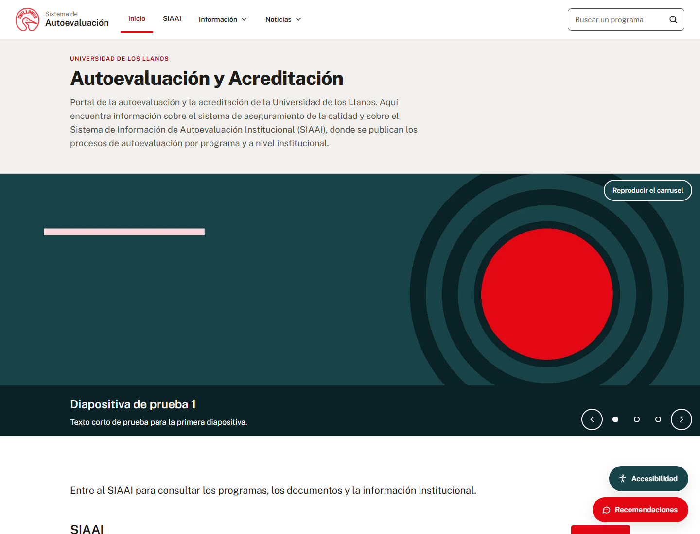

El botón **Accesibilidad** abre un panel con el tamaño del texto (100, 115, 130 y 150 %), alto contraste, subrayar los enlaces, más espacio entre líneas y letras, y menos movimiento, más un botón **Restablecer** que lo devuelve todo a como estaba. Lo que elija cada persona se guarda en su navegador y vale para todo el sitio. El panel se cierra con la tecla Esc, con el botón de cerrar o con un clic fuera de él.

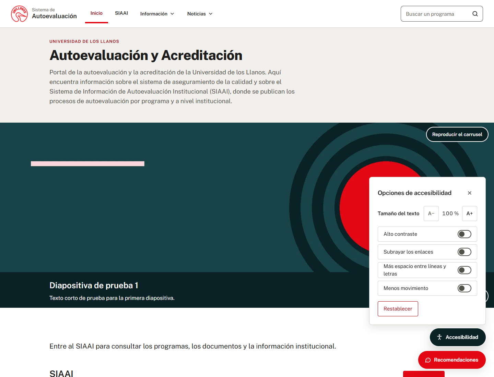

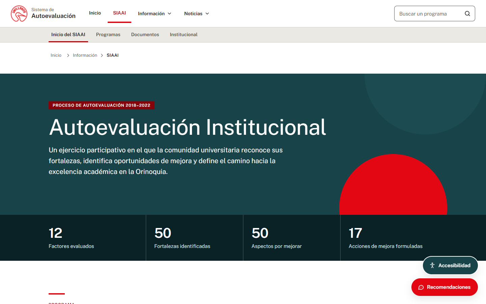

### La barra de edición

Con la sesión abierta aparece una barra clara arriba de todas las páginas (sobre el encabezado), con cuatro opciones:

| Opción | Para qué sirve |
|---|---|
| **Modo edición** | Muestra u oculta los lápices y los botones «+» sobre el contenido. |
| **Editar la cabecera y el pie** | Abre el formulario de la cabecera, las redes, el botón de accesibilidad y el pie. |
| **Panel avanzado** | Abre `/admin/acreditacion`, la lista de programas con todos sus accesos de edición. |
| **Cerrar sesión** | Termina la sesión. Hágalo siempre en un computador compartido. |

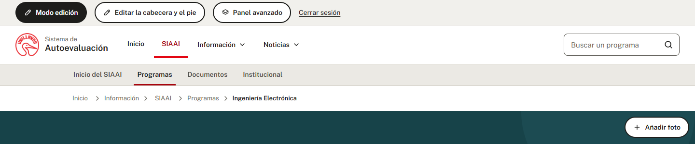

La barra solo la ven las cuentas de Acreditación; el público nunca la ve.

### Modo edición, lápiz y «+»

1. Pulse **Modo edición**. El botón queda marcado y aparecen los botones de edición.
2. Un **lápiz** abre el formulario de lo que está al lado (la ficha del programa, una valoración, una norma…).
3. Un **«+»** abre el formulario para crear algo nuevo (un documento, una dependencia, una diapositiva…).
4. El formulario se abre en un **panel a un lado**, sin salir de la página. Al guardar, la página se recarga con el cambio.
5. Para ocultar los botones, pulse otra vez **Modo edición**. El navegador recuerda su elección.

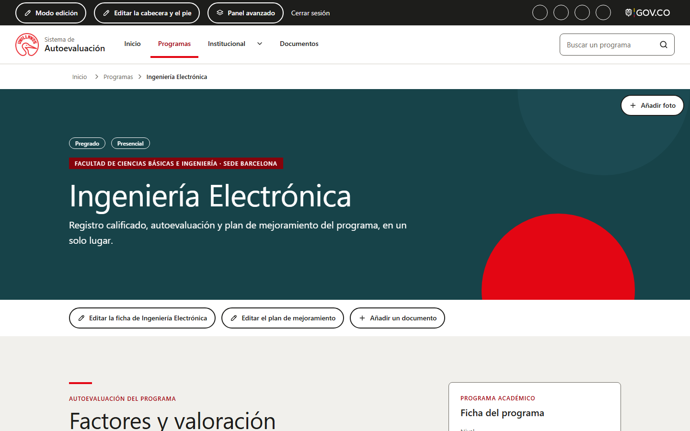

### El panel avanzado

El **Panel avanzado** lista los programas publicados con una fila por programa. En cada fila, **Accesos de edición** despliega los enlaces para editar la ficha, crear o editar el proceso, las valoraciones, los hallazgos, el plan, las metas, los seguimientos y los documentos de ese programa. Arriba hay un buscador de programas y los accesos generales. La sección **Institucional** reúne lo de procesos institucionales, dependencias, directivos, normatividad y cifras.

Por ahora el proceso, los hallazgos, el plan, las metas y los seguimientos se crean desde el panel avanzado. En la página del programa hay «+» para añadir una valoración (cuando ya existe un proceso) y un documento.

## 2. Qué es cada cosa

| Palabra | Qué es |
|---|---|
| **Programa** | Un programa académico de la Universidad, con su ficha (facultad, nivel, sede, director…). Hay 40. |
| **Proceso** | Una vuelta de autoevaluación de un programa o de una sede. De él cuelgan las valoraciones, los hallazgos, el plan y los documentos. |
| **Modelo (lineamiento)** | La norma con la que se evalúa un proceso: el Acuerdo CESU 02 de 2020 o el Acuerdo CESU 01 de 2025. Los dos modelos no tienen equivalencias entre sí. Se elige al crear el proceso. |
| **Factor** y **característica** | Los elementos del modelo. El formulario los llama **Elemento del modelo**. Los dos modelos de programa (2020 y 2025) traen 12 factores y sus características; el modelo institucional también tiene 12. |
| **Valoración** | La nota de un factor o de una característica en un proceso. Solo se valoran factores y características. |
| **Hallazgo** | Una fortaleza o un aspecto por mejorar que dejó la autoevaluación. |
| **Plan de mejoramiento** | El plan del proceso (formato FO-GCL-20). |
| **Meta** | Una acción del plan, con su descripción, responsables e indicadores. |
| **Seguimiento** | El avance reportado de una meta en un periodo (por ejemplo 2025-1). |
| **Documento** | Un archivo o un enlace externo (por ejemplo, una carpeta de Google Drive). |
| **Galería de imágenes** | Las imágenes del carrusel propio de un programa o de la página Institucional (hasta 10, cada una con su texto alternativo). Son distintas de las diapositivas de la portada. |
| **Noticia**, **Página informativa** y **Miembro del equipo** | El contenido del sitio de Acreditación: las noticias, las páginas de texto (SAC, Modelo de Autoevaluación, Boletines…) y las personas del equipo. |
| **Recomendación** | Lo que envía alguien de la comunidad desde el formulario Participa. |

### Quién puede hacer qué

Hay tres roles. Las cuentas las crea la persona administradora.

| Rol | Qué puede |
|---|---|
| **Acreditación** | Crea y edita todo lo de este manual: programas y su autoevaluación, documentos, diapositivas, dependencias, normas, noticias, páginas informativas, equipo y la cabecera y el pie. No borra lo que no creó y no entra a la configuración del sitio. |
| **Editor de documentos** | Solo crea y edita documentos, borra los que subió y decide si se publican. No ve el resto. |
| **Gestor de participación** | Lee las recomendaciones enviadas y les pone un estado y una respuesta. No borra envíos ni cambia el formulario. |

## 3. Crear un programa con su autoevaluación, de principio a fin

El ejemplo usa el Factor 1 del modelo 2020. El orden importa: cada paso necesita el anterior.

### Paso 1. El programa

1. Entre, active **Modo edición** y abra **Programas** en el menú.
2. Pulse **Añadir programa**.
3. Escriba el **Título** con el nombre completo del programa, la **Clave** (una palabra sin espacios ni tildes que identifica al programa y forma su dirección, por ejemplo `ingenieria-electronica`; no se repite entre programas) y elija la **Facultad** y el **Nivel**. Los cuatro son obligatorios. Complete lo que sepa: modalidad, sede, duración en semestres, director, código SNIES y las resoluciones. Lo que no sabe, déjelo en blanco: el sitio no muestra lo vacío.
4. Deje marcado **Publicado** cuando quiera que se vea en el sitio público.
5. Pulse **Guardar**.

### Paso 2. El proceso

1. En el **Panel avanzado**, busque el programa y abra **Accesos de edición**.
2. En **Procesos**, pulse **Crear un proceso**. El programa ya viene elegido.
3. Elija el **Tipo de proceso** (registro calificado, acreditación, renovación de la acreditación o acreditación internacional) y el **Ámbito** «Programa».
4. Elija el **Modelo (lineamiento)** con el que se evaluó. De él dependen los factores que podrá elegir después.
5. Elija el **Estado** (por ejemplo planeado, en curso o finalizado) y, si lo conoce, el **Periodo evaluado** (por ejemplo 2018-2022), la **Fase actual** y el **Resultado**.
6. Escriba un **Título** claro y pulse **Guardar**.

### Paso 3. Las valoraciones

1. En la página del programa, con **Modo edición**, pulse el «+» del factor que quiere valorar. También puede entrar por **Valoraciones › Crear una valoración** del panel avanzado.
2. El **Proceso** ya viene elegido. Si entró por el panel, elíjalo primero: el campo **Elemento del modelo** solo ofrece los elementos del modelo de ese proceso.
3. En **Elemento del modelo**, escriba una parte del nombre y elíjalo de la lista. Los factores no se buscan por número: el Factor 1 del modelo 2020 se llama «Proyecto educativo del programa e identidad institucional». Si escribe solo «Proyecto educativo del programa» obtiene una característica, no el factor.
4. Escriba la **Valoración**, entre 1,00 y 5,00. El **grado** se calcula solo al guardar: no se escribe.
5. Escriba un **Título** que lo identifique (por ejemplo «Factor 1 · Ingeniería Electrónica 2018-2022»): es obligatorio. Complete los demás campos si los tiene (ver la sección 4) y deje marcado **Publicado**.
6. Pulse **Guardar**.

Cada proceso admite una sola valoración por elemento: si intenta repetirla, el formulario lo avisa.

### Paso 4. Los hallazgos

1. En el panel avanzado, en **Hallazgos**, pulse **Crear un hallazgo**.
2. Elija el **Tipo de hallazgo**: **Fortaleza** o **Aspecto por mejorar**.
3. Escriba la **Descripción** y un **Título** corto que la resuma (por ejemplo «Fortaleza del Factor 1»): el título es obligatorio.
4. Elija el **Elemento del modelo** al que pertenece. Un hallazgo sin elemento es válido, pero no aparece dentro de ningún factor.
5. El **Destino** (plan de mejoramiento, plan de acción o ninguno) se propone solo al crear el hallazgo, según la valoración del elemento: menor de 4, plan de mejoramiento; igual a 4, plan de acción; mayor de 4, ninguno. Si el elemento no tiene valoración propia se usa la de su factor. Usted puede cambiarlo. La regla está pendiente de confirmar con Acreditación.
6. Deje marcado **Publicado** y pulse **Guardar**.

### Paso 5. El plan de mejoramiento

1. En el panel avanzado, en **Plan de mejoramiento**, pulse **Crear el plan de mejoramiento**.
2. Escriba un **Título** (por ejemplo «Plan de mejoramiento 2024-2 a 2030»): es obligatorio.
3. Elija el **Tipo de plan** (institucional o de programa) y complete el código y la versión del formato, el periodo y la fecha de suscripción si los tiene.
4. Deje marcado **Publicado** y pulse **Guardar**.

### Paso 6. Las metas y los seguimientos

1. En **Metas**, pulse **Crear una meta**. Escriba un **Título** (por ejemplo «Meta 1»), elija el **Plan de mejoramiento**, escriba el **Número** y la **Descripción de la meta**, y elija los **Hallazgos que atiende** y los **Responsables**. Deje marcado **Publicado**.
2. En **Seguimientos**, pulse **Crear un seguimiento**. Escriba un **Título** (por ejemplo «Meta 1 · 2025-1»), elija la **Meta**, escriba el **Periodo** (por ejemplo 2025-1), el **Estado** (borrador, reportado o verificado) y el **Avance**. Deje marcado **Publicado**.

El avance que muestra el sitio es el del periodo más reciente de cada meta, y se muestra como lo reportó el programa, sin verificar.

### Paso 7. Los documentos y la foto

Suba el informe y el plan como documentos del proceso (sección 5) y, si quiere, la foto y la galería de imágenes del programa (sección 5).

### Paso 8. Publicar

Un contenido solo se ve en el sitio si tiene marcado **Publicado**. La página de un programa muestra el proceso publicado más reciente. Revise el programa con una ventana privada del navegador para ver lo que ve el público.

## 4. Qué hace cada campo de la valoración

Qué campos de la valoración deben verse en la página pública de cada valoración es una decisión pendiente con Acreditación.

| Campo | Qué hace hoy |
|---|---|
| **Proceso** y **Elemento del modelo** | Obligatorios. Un mismo proceso no puede tener dos valoraciones del mismo elemento. El elemento debe ser del modelo del proceso. |
| **Valoración** | Se valida entre 1,00 y 5,00. Con ella el sitio calcula el grado y se muestra en la tarjeta del factor. |
| **Grado de cumplimiento** | No se escribe: se calcula al guardar a partir de la valoración, redondeada a un decimal, según la tabla de grados. Hay huecos en la tabla (de 4,7 a 4,8 y de 3,9 a 4,0): la regla de redondeo está pendiente de confirmar con Acreditación. |
| **Porcentaje** | Se guarda tal como se escribe. No se valida su rango, no se calcula y ningún cálculo lo usa. No aparece en la página del programa, pero sí en la página propia de la valoración (`/node/<número>`), que es pública cuando la valoración está publicada. |
| **Ponderación** | Igual que el porcentaje: se guarda, no se valida ni se calcula y ningún cálculo la usa. Solo se ve en la página propia de la valoración, si tiene valor. |
| **Juicio** y **Síntesis** | Textos que se guardan tal cual. No aparecen en la página del programa; sí en la página propia de la valoración, si tienen texto. |
| **Estado de la condición** | Cumple, cumple parcialmente o no cumple. El propio campo dice que es solo para condiciones de registro calificado, pero el sitio no lo exige. Se guarda, no se calcula y no aparece en la página del programa (sí en la página propia de la valoración). |
| **Documento soporte** | Enlaza un documento con la valoración. Un documento que una valoración usa no se puede eliminar. |

## 5. Documentos, fotos, carruseles, noticias, Institucional, Participa y cabecera

### Subir un documento (archivo o enlace)

1. Pulse el «+» **Añadir un documento** de la página del programa, o **Subir un documento** del panel avanzado.
2. Escriba el **Nombre**, como debe verse en la lista.
3. En **¿Qué va a cargar?** elija **Archivo** o **Enlace**. Solo se guarda lo que elija: si elige Enlace, el archivo no se guarda, y al revés.
4. Con **Archivo**, suba el archivo (PDF, Word, Excel, PowerPoint y similares). Con **Enlace**, escriba la dirección completa, que debe empezar por `https://` (por ejemplo, una carpeta de Google Drive).
5. Elija la **Categoría** y, si el documento es de un programa, el **Proceso**. Complete fecha y versión si las tiene.
6. Deje marcado **Publicado** y pulse **Guardar**.

Un documento lleva un archivo **o** un enlace, nunca los dos ni ninguno: el formulario avisa con un mensaje claro. Un enlace se ve en las listas como «Enlace» o «Carpeta de Drive», con un ícono de enlace, y se abre en una pestaña nueva.

Los documentos con una dependencia o una facultad, y los de un proceso institucional por sede, salen en las páginas de «Institucional» y no en «Documentos».

### Cambiar la foto de un programa

1. En la página del programa, con **Modo edición**, pulse **Cambiar foto** (o **Añadir foto** si todavía no tiene).
2. Elija la foto o arrástrela sobre el recuadro. Se sube sola.
3. Escriba la **Descripción de la foto**: es obligatoria y la leen los lectores de pantalla.
4. Pulse **Guardar foto**.

La foto debe ser JPG, PNG o WebP, de hasta 5 MB y de al menos 1280 píxeles de ancho. Use solo fotos de la Universidad o con permiso de uso.

### El carrusel de imágenes de un programa

Cada programa puede tener su propio carrusel, que se ve entre el texto con la ficha y las tarjetas de factores. Las imágenes son solo de ese programa, no de la portada ni de otro.

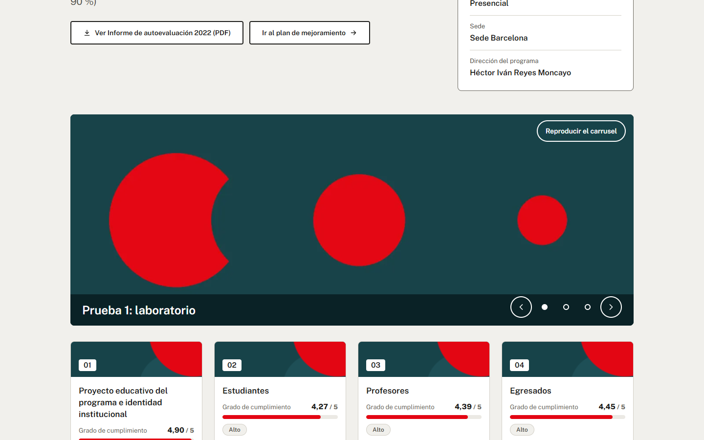

1. Abra la edición del programa (en **Modo edición**, el lápiz **Editar la ficha de…**, o desde el **Panel avanzado**).
2. Busque **Galería de imágenes**, elija la imagen o arrástrela sobre el recuadro (hasta 10). Se sube sola.
3. Escriba el **Texto alternativo** de cada imagen: es obligatorio y lo leen los lectores de pantalla.
4. Si quiere, escriba el **Título** de la imagen: aparece como leyenda sobre una franja oscura. Sin título, solo se ve la imagen.
5. Para cambiar el orden, arrastre las imágenes por la cruz de la izquierda.
6. Guarde.

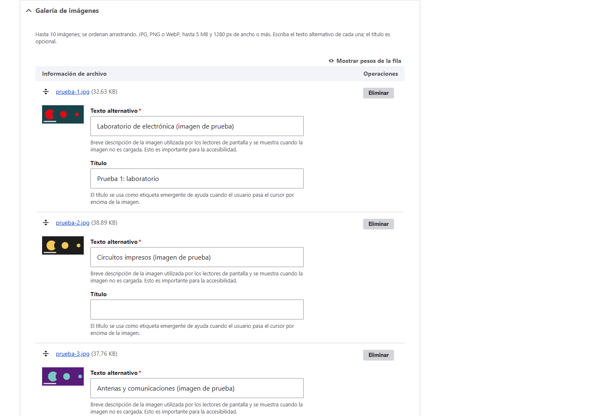

El carrusel cambia solo cada pocos segundos con un fundido; se detiene al pasar el ratón, al enfocarlo con el teclado y con su botón **Pausar el carrusel**. Con una sola imagen se ve fija, sin flechas ni puntos. Sin imágenes, el programa no muestra carrusel. Cada imagen debe ser JPG, PNG o WebP, de hasta 5 MB y de al menos 1280 píxeles de ancho; se muestra con proporción 16:6, recortada al centro.

### El carrusel de la portada

El carrusel va en la portada (`/`), debajo del encabezado, y muestra hasta cinco diapositivas publicadas, por orden. Cambia solo cada 5,5 segundos con un fundido, se detiene al pasar el ratón y tiene su botón **Pausar el carrusel**. Sin diapositivas no aparece.

1. En la portada, con **Modo edición**, pulse **Añadir una diapositiva**. Cada diapositiva existente tiene su lápiz.
2. Escriba el **Título** (el titular, hasta 90 caracteres).
3. Suba la **Imagen** (JPG, PNG o WebP, hasta 5 MB y de al menos 1600 píxeles de ancho) y escriba su descripción, que es obligatoria.
4. Si quiere, escriba un **Texto corto** (hasta 160 caracteres) y un **Enlace**: una página del sitio (por ejemplo `/programas`) o una dirección que empiece por `https://`.
5. En **Orden**, escriba un número: la 1 sale primero. Las que no llevan número salen al final.
6. Deje marcado **Publicado** y pulse **Guardar**.

Las tres diapositivas de prueba («Diapositiva de prueba 1» a «3») se cargaron con la migración inicial: usted puede despublicarlas cuando tenga las imágenes reales, y la persona administradora las elimina.

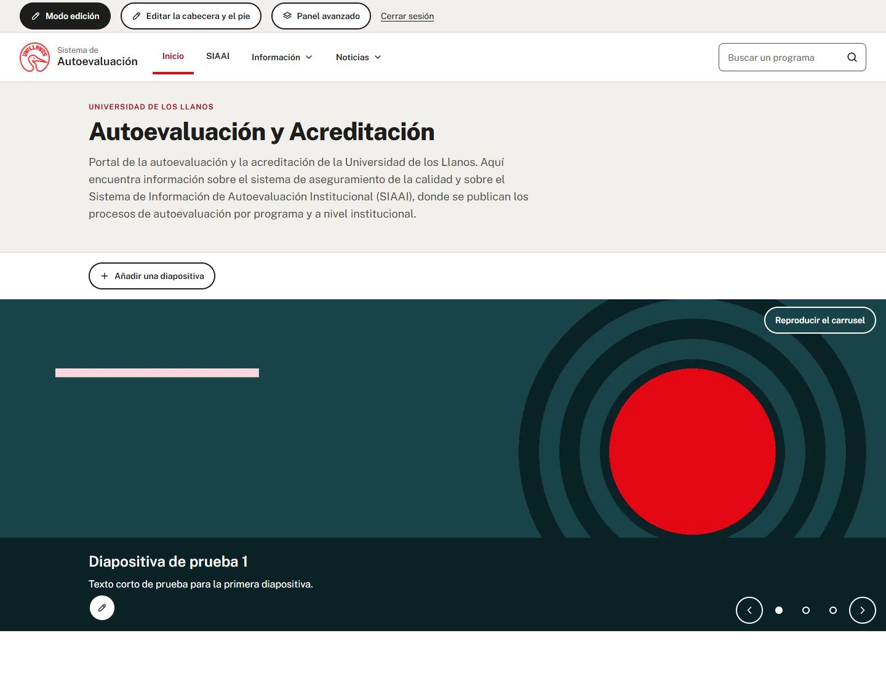

### Lo institucional

**Institucional** (`/institucional`, en la barra secundaria del SIAAI) es una sola página, con la misma interfaz que la de un programa pero aplicada a la Universidad. Arriba va la ficha del proceso institucional y, si ese proceso tiene valoraciones, sus factores y su plan. Debajo van las secciones que tengan contenido, con una barra para saltar a cada una. Las direcciones antiguas (`/institucional/dependencias`, `/institucional/directivos`…) llevan a la sección que corresponde.

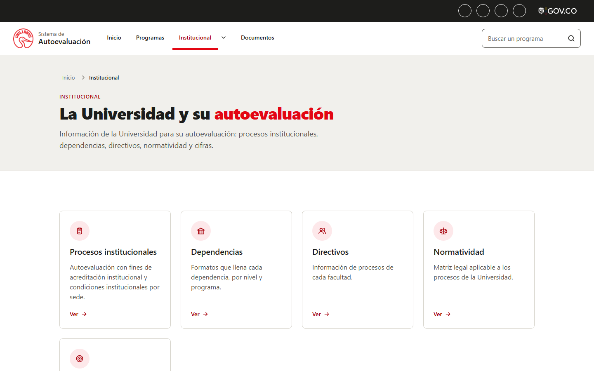

| Sección | Qué contiene | Cómo se edita |
|---|---|---|
| **Documentos** | Los documentos del proceso institucional más reciente. | Lápiz del proceso y «+» para añadir un documento. Para crear un proceso, **Crear un proceso institucional** en el panel avanzado (con Ámbito «Institucional» y una sede, sin programa). |
| **Condiciones por sede** | Las condiciones institucionales de cada sede, con sus documentos. | «+» junto a cada proceso de condiciones de la sede, para añadir un documento. |
| **Dependencias** | Una entrada por dependencia con los formatos por nivel y programa, y un buscador. | **Añadir una dependencia**, y «+» de cada entrada para añadir un formato (un documento con enlace). |
| **Directivos** | Una tarjeta por facultad. Si tiene un solo documento, la tarjeta va directo a él; si tiene varios, abre una lista. | «+» de la facultad para añadir un documento. |
| **Normatividad** | La matriz legal en una tabla con filtros por origen y tipo de norma y un buscador. | **Añadir una norma** y el lápiz de cada norma. Origen, tipo y epígrafe son obligatorios. |
| **Cifras** | Enlaces a cifras nacionales y un tablero institucional que solo se carga si se pulsa «Cargar el tablero». | **Editar la introducción y los enlaces de cifras** (formulario del micrositio). |

Para una dependencia, el documento lleva la **Dependencia** y, si corresponde, el **Programa**. Para los directivos, la **Facultad** y la categoría «Directivos».

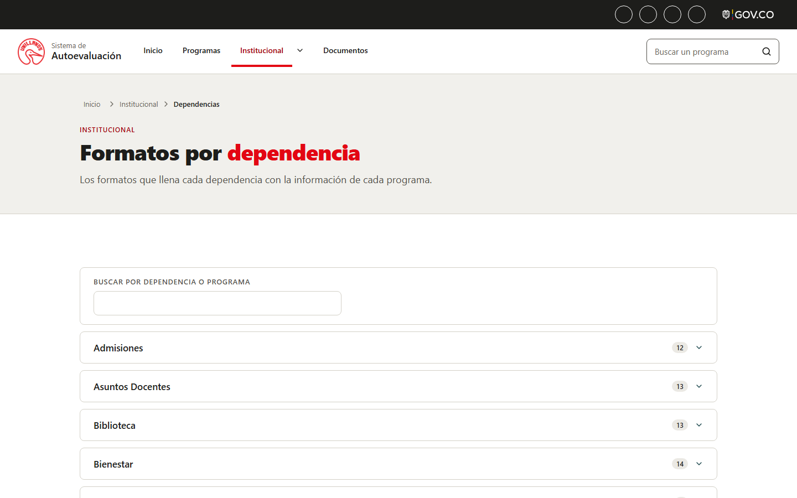

**El carrusel de imágenes de Institucional.** Las imágenes de la página **Institucional** se suben en la **Galería de imágenes** del proceso institucional (el más reciente, el que no es de un programa ni de condiciones por sede): abra ese proceso con su lápiz y use el mismo campo que en un programa. Si más adelante se crea un proceso institucional más nuevo, la página usa el de ese proceso y habrá que subir de nuevo las imágenes.

### Noticias, páginas informativas y equipo

Los desplegables **Información** y **Noticias** del menú muestran el contenido del sitio de Acreditación. Las tres noticias más recientes salen también en la portada.

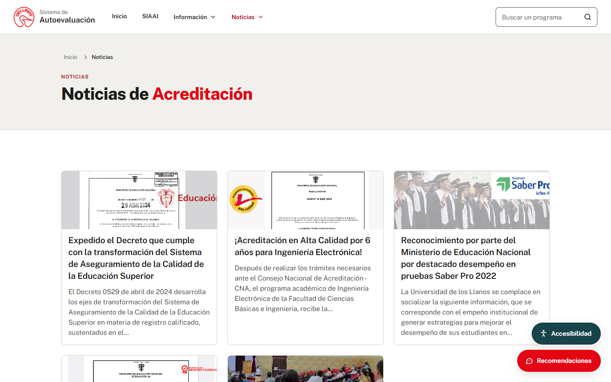

| Qué es | Dónde se ve | Qué lleva |
|---|---|---|
| **Noticia** | `/noticias` | **Título**, **Texto** (obligatorio), **Imagen** (opcional; si la sube, el texto alternativo es obligatorio) y **Enlace de origen** (opcional; se recomienda que empiece por `https://`). No lleva fecha. |
| **Página informativa** | SAC, Modelo de Autoevaluación, Boletines y Capacitaciones | **Título**, **Texto** (obligatorio) y **Enlace de origen** (opcional; se recomienda que empiece por `https://`). |
| **Miembro del equipo** | `/nuestro-equipo` | **Título** (el nombre), **Dependencia o cargo** (obligatorio), **Grupo**, **Teléfono**, **Correo electrónico** y **Orden**. La página las agrupa por **Grupo**. |

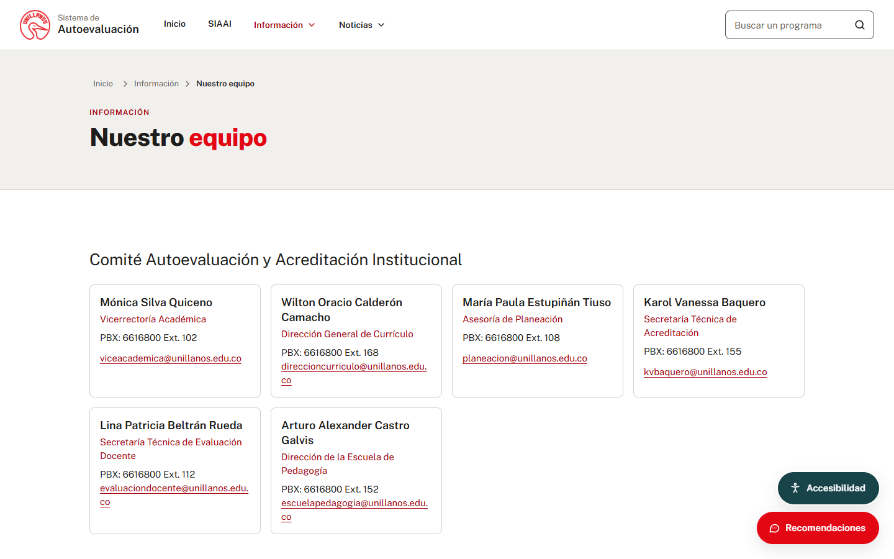

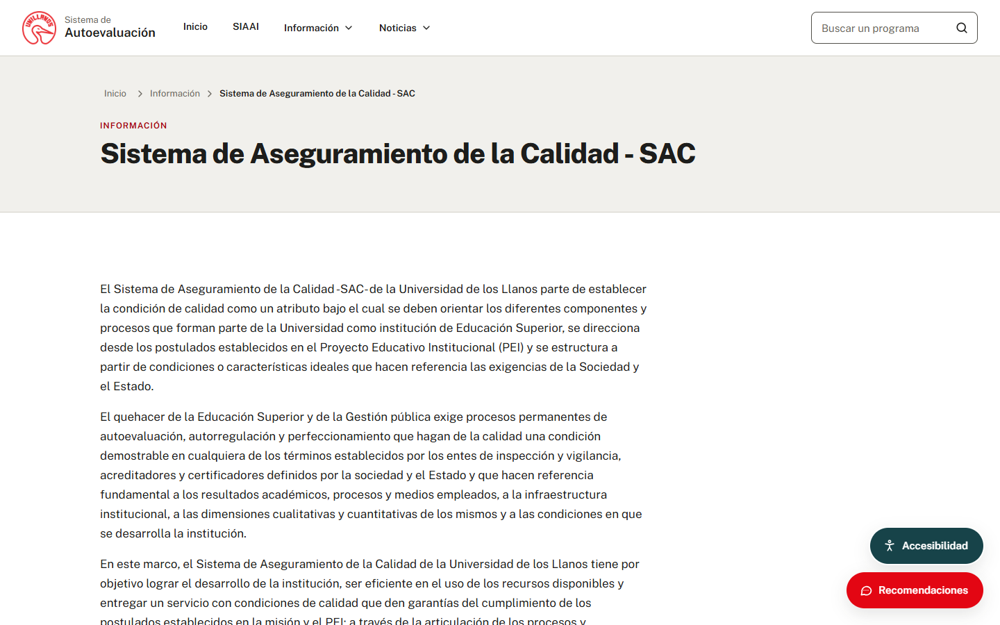

Estas pantallas todavía no tienen un acceso en el panel avanzado ni un «+» en la página. Para crear una, escriba en el navegador la dirección del sitio seguida de `/node/add/noticia`, `/node/add/pagina_informativa` o `/node/add/miembro_equipo`. Para modificar una existente, abra **Todo el contenido** en el panel avanzado (o `/admin/content`), busque el contenido y pulse **Editar**. Deje marcado **Publicado** y pulse **Guardar**.

### Participa y las recomendaciones

**Participa** (`/participa`) es el formulario donde la comunidad envía recomendaciones para la mejora continua. También se llega desde el botón flotante **Recomendaciones**.

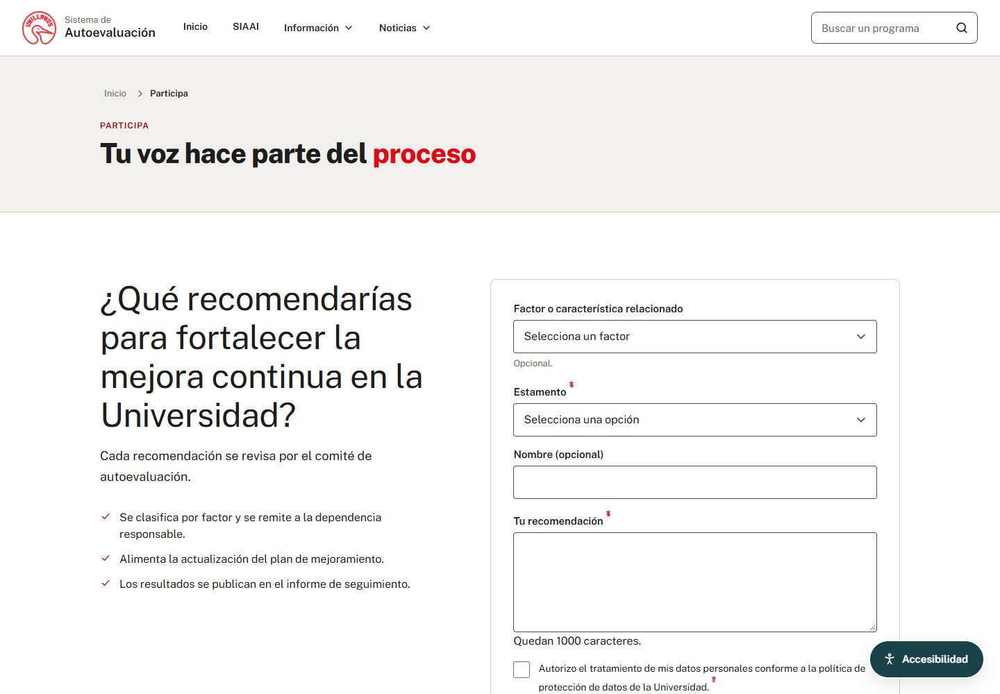

Quien escribe elige su **Estamento** y escribe **Tu recomendación** (hasta 1000 caracteres); el **Factor o característica relacionado** y el **Nombre** son opcionales, y debe marcar la autorización de datos personales. Un mismo visitante puede enviar hasta 5 recomendaciones por hora. El sitio no envía correos y no guarda la dirección de internet de quien escribe.

Las recomendaciones las lee quien tiene el rol **Gestor de participación**, que las abre en `/admin/structure/webform/manage/participa/results/submissions`. Ahí le pone a cada una un **Estado de gestión** (Recibida, En revisión, Respondida o Descartada) y, si quiere, una **Respuesta**; el público no ve ninguno de los dos. Si usted necesita ver las recomendaciones, pida a la persona administradora que le dé ese rol.

### La cabecera y el pie

1. En la barra de edición pulse **Editar la cabecera y el pie**.
2. Cambie lo que necesite: nombre del sistema, redes sociales, título del botón de accesibilidad, datos del pie, políticas, logos y derechos. Lo que deje vacío no se muestra.
   En el grupo **Portal de inicio: texto, accesos y sitios de interés** se cambian el **Título de la portada**, el **Texto de bienvenida** (separe los párrafos con una línea en blanco), los **Accesos** (uno por línea, «Título | Descripción corta | URL») y los **Sitios de interés** (uno por línea, «Nombre | URL», con URL que empiece por `https://`).
3. En el grupo **Institucional: introducción y cifras** puede cambiar la frase de la página de «Institucional» y los enlaces de «Cifras» (uno por línea: «Título | Descripción corta | URL», con URL que empiece por `https://`).
4. Pulse **Guardar configuración**.

Las redes sociales y el logo de GOV.CO van en el pie (ya no hay una franja negra arriba). El botón de accesibilidad abre sus opciones aunque deje vacía su dirección: esa dirección es solo un enlace extra a una página de accesibilidad.

### En el celular

El sitio se adapta al celular: el menú pasa a un botón, las tablas se vuelven tarjetas, el carrusel se ve con la imagen arriba y el titular debajo, y los botones flotantes muestran solo su ícono.

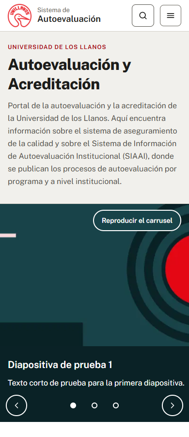

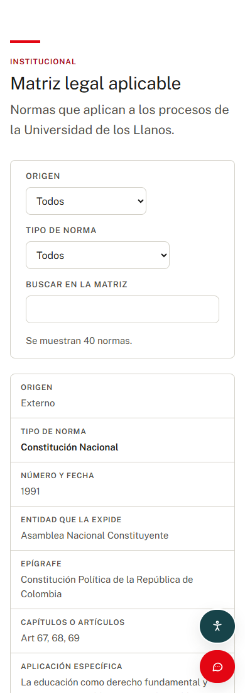

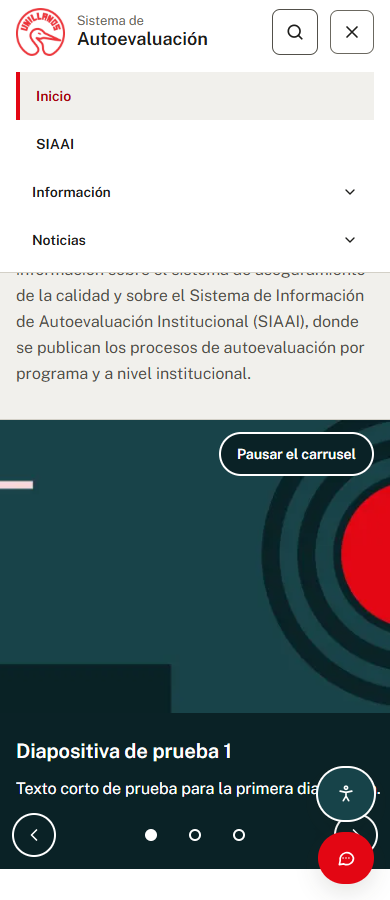

## 6. Publicar, despublicar y eliminar

### Publicar y despublicar

Cada formulario tiene la casilla **Publicado**. Si la quita, el contenido deja de verse en el sitio público, pero no se pierde: sigue en la lista de contenido y puede volver a publicarlo. Para encontrar lo que no está publicado use **Contenido sin publicar** en el panel avanzado.

### Eliminar

Solo puede eliminar lo que creó **su misma cuenta**. Lo cargado por la migración inicial (los 40 programas, por ejemplo) solo lo elimina la persona administradora.

1. Abra el formulario del contenido (lápiz) y pulse **Eliminar**.
2. El sitio explica qué se va a eliminar y a qué pertenece, y avisa que no se puede deshacer.
3. Pulse **Sí, eliminar** o **Cancelar**.

El sitio registra quién eliminó qué y cuándo.

### Por qué a veces no deja eliminar

No hay borrado en cascada: si otro contenido apunta al que quiere eliminar, el sitio lo bloquea y lista lo que depende de él. Hay que eliminar primero lo que cuelga. Para borrar un programa entero, el orden es:

1. Seguimientos.
2. Metas.
3. Plan de mejoramiento.
4. Hallazgos.
5. Valoraciones.
6. Documentos.
7. Proceso.
8. Programa.

También se bloquea una dependencia o un programa que tiene documentos apuntando a él, y un documento que una valoración usa como soporte. Quien tiene permisos de administración no se bloquea. Usted tampoco puede cambiar el autor ni la fecha de un documento.

## 7. Problemas comunes

| Qué pasa | Qué hacer |
|---|---|
| No veo los lápices ni los «+». | Active **Modo edición** en la barra que aparece sobre el encabezado. Si no hay barra, la sesión se cerró: vuelva a entrar por `/acceso-acreditacion`. |
| En «Elemento del modelo» no aparece el factor que busco. | Elija primero el **Proceso**: solo se ofrecen los elementos de su modelo. Busque por el nombre, no por «Factor 1». |
| «Un proceso tiene sede o programa, no ambos.» | Un proceso lleva programa **o** sede. Deje en blanco el que no corresponde. |
| El formulario del documento pide «un archivo o un enlace». | Elija una de las dos opciones y llene solo ese campo. El enlace debe empezar por `https://`. |
| La foto no sube. | Debe ser JPG, PNG o WebP, de hasta 5 MB y con el ancho mínimo que dice la ayuda del campo. |
| El sitio no me deja eliminar. | Algo depende de ese contenido (ver «Por qué a veces no deja eliminar») o no lo creó su cuenta. |
| Guardé y no se ve en el sitio. | Revise que **Publicado** esté marcado y, en un programa, que el proceso esté publicado. |
| Una norma o una dependencia no aparece en su página. | Debe estar publicada. En normas, origen, tipo y epígrafe son obligatorios. |
| No encuentro cómo crear una noticia, una página informativa o una persona del equipo. | Escriba `/node/add/noticia`, `/node/add/pagina_informativa` o `/node/add/miembro_equipo` después del nombre del sitio (ver «Noticias, páginas informativas y equipo»). |
| El carrusel de mi programa no aparece. | Revise que **Galería de imágenes** tenga al menos una imagen y que el programa esté publicado. Con una sola imagen se ve fija, sin flechas. |
| La imagen de la galería no sube o pide el texto alternativo. | Debe ser JPG, PNG o WebP, de hasta 5 MB y de al menos 1280 píxeles de ancho, y cada imagen lleva su **Texto alternativo**. |
| No veo las recomendaciones que enviaron. | Hace falta el rol **Gestor de participación**; pídalo a la persona administradora. |
| El botón «Accesibilidad» no cambia el tamaño del texto en mi computador. | Las opciones se guardan en el navegador: revise que no esté bloqueando el almacenamiento del sitio y recargue la página. |

Para todo lo demás, escriba a la persona administradora del sitio, con la dirección de la página y una captura de lo que ve.
