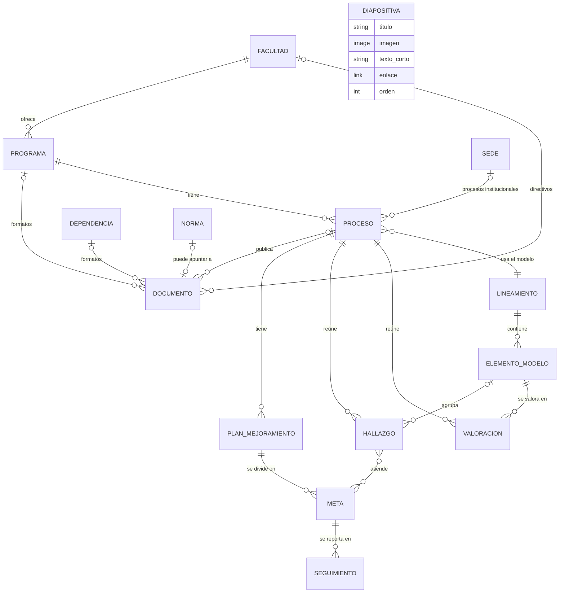

# Manual técnico

Para quien mantenga el código del Sistema de Información de Autoevaluación de la Universidad de los Llanos. El sitio publica, por programa y a nivel institucional, los procesos de autoevaluación, las valoraciones por factor y característica, las fortalezas y los aspectos por mejorar, el plan de mejoramiento (FO-GCL-20) con su seguimiento, los documentos y lo institucional (dependencias, directivos, normatividad y cifras). El idioma del sitio, del código comentado y de esta documentación es el español.

Las reglas de trabajo del equipo están en `CLAUDE.md`. Este manual explica cómo está armado el sistema y cómo cambiarlo sin romperlo.

## 1. Arquitectura

| Pieza | Versión o ubicación |
|---|---|
| Drupal | 11.4.11 |
| PHP | 8.4 (compatible con 8.3 o superior) |
| Base de datos | MariaDB 11.8 |
| Entorno local | DDEV (`.ddev/config.yaml`, proyecto `autoeval-unillanos`) |
| Raíz de Composer | `drupal/` |
| Raíz web | `drupal/web` |
| Configuración | `drupal/config/sync` |
| Tema | `drupal/web/themes/custom/unillanos` |
| Módulos propios | `drupal/web/modules/custom/`: `unillanos_autoeval`, `unillanos_migrate`, `unillanos_guia` |
| Datos de carga | `datos/semillas/` y `datos/importacion/<programa>/` |
| Prototipo visual | `plantilla/` (de solo lectura) |
| Documentos fuente | `docs/fuentes/` (de solo lectura) |
| Documentación | `docs/` (se empieza por `docs/IMPLEMENTACION_DRUPAL.md`) |

Todo comando se escribe con el prefijo `ddev`, desde la raíz del repositorio: `ddev drush cr`, `ddev composer install`.

Módulos de terceros que usa el proyecto: `paragraphs`, `webform`, `pathauto`, `field_group`, `auto_entitylabel`, `token`, `better_exposed_filters`, `migrate_plus`, `migrate_tools` y `migrate_source_csv`. Nunca se edita `web/core`, `web/modules/contrib` ni `vendor/`.

### Los tres módulos propios

- **`unillanos_autoeval`** concentra las reglas de negocio: el cálculo del grado, las restricciones de validación, los servicios que arman cada página, los permisos propios, el panel de Acreditación, el modo edición y las páginas públicas (`/inicio`, `/programas`, `/documentos` y `/institucional…`).
- **`unillanos_migrate`** carga los datos desde los CSV con migraciones (`migrate_plus`).
- **`unillanos_guia`** es la guía de estilos del tema. Solo es para desarrollo: se desactiva en producción.

### El tema `unillanos`

- Componentes SDC (single directory components) en `components/`: cada uno tiene `*.component.yml`, `*.twig` y, si hace falta, `*.css` y `*.js`. Mantienen el marcado y las clases `ua-*` de `plantilla/`.
- Los estilos usan los tokens de `css/tokens.css`: rojo de marca `#e30613` (solo decorativo o grande), rojo de texto `#a8040e`, verde azulado `#174349` y `#0a2226`, carbón `#1d1d1b`, tipografía Public Sans en pesos 400 y 600. Radios 4, 8 y de píldora; sin sombras; objetivos táctiles de al menos 44 px; un solo anillo de foco.
- El JavaScript usa `Drupal.behaviors` con `once()` y los atributos `data-ua-*`. No usa `innerHTML`.
- Las plantillas de página (`templates/content/unillanos-*.html.twig`) solo cambian los nombres de las claves que entregan los servicios a las propiedades de los componentes: no deciden nada. Los componentes solo muestran valores guardados; no calculan grados, destinos ni avances.
- Las plantillas de las páginas se registran en el tema (`src/Hook/UnillanosHooks.php`, `hook_theme`) y los controladores del módulo les entregan los datos.

### Cómo se arma una página pública

1. Una ruta (`unillanos_autoeval.routing.yml`) llama a un controlador.
2. El controlador pide los datos a un servicio (`src/Service/`), que consulta con Entity Query, comprueba el acceso y devuelve un arreglo con la caché (etiquetas y contextos).
3. El controlador responde con `#theme` y los datos; el tema los pinta con componentes.

Ejemplo: `/institucional/normatividad` → `InstitucionalController::normatividad()` → `InstitucionalNormas::datos()` → plantilla `unillanos-institucional-normatividad.html.twig` → componente `norm-table`.

## 2. Modelo de datos

La fuente de verdad de los nombres de máquina es `docs/drupal/modelo-de-contenido.md`; el modelo entidad-relación está en `docs/mer/MER.md` y el diccionario en `docs/mer/diccionario-datos.md`. Cada cambio del modelo se refleja en los tres.



| Entidad | Pieza de Drupal | Nombre de máquina |
|---|---|---|
| Programa | Nodo | `programa` |
| Proceso | Nodo | `proceso` |
| Valoración | Nodo | `valoracion` |
| Hallazgo | Nodo | `hallazgo` |
| Plan de mejoramiento | Nodo | `plan_mejoramiento` |
| Meta | Nodo | `meta` |
| Seguimiento | Nodo | `seguimiento` |
| Lineamiento (modelo) | Nodo | `lineamiento` |
| Dependencia | Nodo | `dependencia` |
| Norma | Nodo | `norma` |
| Diapositiva del carrusel | Nodo | `diapositiva` |
| Documento | Medio | `documento` |
| Elemento del modelo (factor, característica, aspecto) | Taxonomía jerárquica | `elemento_modelo` |
| Facultad, sede, grado de cumplimiento, estamento, responsable, proyecto institucional | Taxonomías | `facultad`, `sede`, `grado_cumplimiento`, `estamento`, `responsable`, `proyecto_institucional` |
| Participación, indicador, programación anual | Paragraphs | `participacion`, `indicador`, `programacion_anual` |

### Reglas del dominio que no son obvias

- El modelo se declara por proceso (`proceso.field_lineamiento`) y no hay equivalencias entre los modelos. Hay cuatro lineamientos: el Acuerdo CESU 02 de 2020 y el Acuerdo CESU 01 de 2025 (modelos de programa), «Acuerdo CESU 01 de 2025 (instituciones)» (modelo institucional, clave `CESU2025-INST`) y el Decreto 1330 de 2019 (condiciones de registro calificado). Un proceso solo admite los tres de tipo acreditación; el Decreto 1330 no es modelo de un proceso. El ámbito del modelo debe corresponder al del proceso (un proceso de programa usa un modelo de programa; uno institucional, uno institucional). Los procesos institucionales pueden quedar sin modelo.
- El grado se calcula, no se digita: `hook_node_presave` de `valoracion` llama a `CalculadorGrado`, que redondea la valoración a un decimal y la ubica en los rangos de `grado_cumplimiento`. La tabla 3.1 deja huecos (de 4,7 a 4,8 y de 3,9 a 4,0): la regla de redondeo está pendiente con Acreditación.
- Las valoraciones son solo para factor y característica. La pareja (proceso, elemento) es única.
- Un documento lleva un archivo o un enlace `https://`, no ambos ni ninguno (restricción `UnillanosArchivoOEnlace`).
- Un proceso lleva sede o programa, no ambos (restricción `UnillanosProcesoSedeOPrograma`).
- Sin «Publicado» nada se ve. La página de un programa muestra el proceso publicado más reciente.
- Lo vacío se omite, sin etiquetas de «Pendiente». La excepción deliberada es la tarjeta de programa, que reserva un hueco sin texto.

### Restricciones de validación (`src/Plugin/Validation/Constraint/`)

| Restricción | Qué valida |
|---|---|
| `UnillanosClaveUnica` | Que la clave (`field_clave`) de un programa o de un elemento del modelo no se repita. |
| `UnillanosValoracionUnica` | Una valoración por proceso y elemento. |
| `UnillanosProcesoSedeOPrograma` | Sede o programa, no ambos ni ninguno. |
| `UnillanosEstadoPorTipo` | El estado de un proceso (planeado, en curso o finalizado) y el de un seguimiento (borrador, reportado o verificado) solo admiten sus propios valores. |
| `UnillanosModeloDelProceso` | El modelo permitido, su ámbito y que los elementos sean de ese modelo. |
| `UnillanosArchivoOEnlace` | Archivo o enlace `https://` en un documento. |
| `UnillanosDiapositiva` | Titular de hasta 90 caracteres y enlace seguro. |

## 3. Roles, permisos y control de acceso

El rol `acreditacion` («Acreditación») es un solo rol que crea y edita programas, procesos, valoraciones, hallazgos, planes, metas, seguimientos, documentos, dependencias, normas y diapositivas. No borra lo que no creó, no accede a configuración, módulos, estructura, personas ni informes, y no tiene ningún permiso `administer …`.

Permisos propios (`unillanos_autoeval.permissions.yml`):

| Permiso | Para qué |
|---|---|
| `access acreditacion panel` | Abrir `/admin/acreditacion` y ver el modo edición. |
| `edit unillanos micrositio` | Abrir el formulario de la cabecera y el pie. |
| `change publication status on acreditacion content` | Marcar o desmarcar «Publicado» en los tipos de autoevaluación y en el medio `documento` (por `hook_entity_field_access`). |

La definición exacta del rol está duplicada, a propósito, en `drupal/config/sync/user.role.acreditacion.yml` y en `config/optional/` del módulo; una prueba exige que sean iguales. Las cuentas las crea el administrador a mano (`register: admin_only`).

Otras reglas:

- Eliminar: `hook_entity_access` impide borrar un contenido al que otro todavía apunta (`EntidadesDependientes::REGLAS`). Solo borra lo propio quien no es administrador. Cada borrado queda en el registro (canal `unillanos_autoeval`).
- Pantallas simples: el modo de formulario `acreditacion` (con ayudas en lenguaje sencillo) reemplaza al formulario completo para quien tiene el rol y no administra el sitio (`SimplificarAcreditacionHooks`). Quien administra conserva los formularios de Drupal.
- Medios: `accessCheck(TRUE)` no basta en las consultas de medios; se comprueba el acceso de cada medio mostrado.

## 4. Rutas

| Ruta | Para qué | Acceso |
|---|---|---|
| `/inicio` (portada) | Portada con carrusel, cifras y programas. | `access content` |
| `/programas` | Listado y buscador de programas. | `access content` |
| `/programas/<alias>` | Página de un programa (plantilla `node--programa--full`). | Contenido publicado |
| `/documentos` | Normatividad y documentos. | `access content` |
| `/institucional` y `/institucional/{procesos,dependencias,directivos,normatividad,cifras}` | Lo institucional. | `access content` |
| `/acceso-acreditacion` | Entrada propia de Acreditación (no se enlaza). | Pública |
| `/admin/acreditacion` | Panel con accesos de edición. | `access acreditacion panel` |
| `/admin/acreditacion/programa/{node}/ficha` y `/foto` | Formularios simples de la ficha y la foto. | Editar el programa |
| `/admin/acreditacion/documento/{media}/editar` y `/nuevo` | Formularios simples de documentos. | Editar o crear documentos |
| `/admin/config/unillanos/micrositio` | Cabecera, franja superior, pie, introducción y cifras. | `edit unillanos micrositio` |

## 5. Configuración del micrositio

El objeto `unillanos_autoeval.micrositio` (valores de instalación en `config/install/`, esquema en `config/schema/`) guarda el nombre del sistema, la URL de la web principal, GOV.CO, las redes, la franja superior, el enlace de accesibilidad, el pie (ubícanos, contacto, líneas, redes, políticas, logos y derechos) y el grupo `institucional` (frase de introducción, enlaces de cifras y URL del tablero). Se edita en `/admin/config/unillanos/micrositio`; el servicio `DatosMarco` lo entrega al tema. Cada URL pasa por `DatosMarco::urlSegura()` antes de imprimirse.

Los enlaces de la cabecera y del pie salen de los menús `main` y `footer`, definidos en `unillanos_autoeval.links.menu.yml`: Inicio, Programas, Institucional (con sus cinco hijos) y Documentos.

## 6. Migraciones y semillas

Los datos entran por migraciones desde CSV, nunca a mano.

| Carpeta | Contenido |
|---|---|
| `datos/semillas/` | Lo común: facultades, sedes, programas, lineamientos, elementos del modelo, grados, estamentos, proyectos, documentos generales, dependencias, normas, procesos institucionales, sus documentos y las diapositivas de prueba. |
| `datos/importacion/<programa>/` | Lo de un programa: proceso, valoraciones, hallazgos, plan, metas, seguimientos, responsables, indicadores y documentos. Hoy solo `ingenieria-electronica`. |
| `datos/semillas/imagenes/` | Las tres imágenes de prueba del carrusel (`scripts/generar-imagenes-carrusel.php`). |

Las migraciones están en `unillanos_migrate/migrations/` (grupo `unillanos`). Las que van por programa llevan la marca `unillanos_por_programa` y se replican solas por cada carpeta de `datos/importacion/` (id `<migración>:<carpeta con guiones bajos>`). Las rutas de archivos de los CSV son relativas a la raíz del repositorio y las valida `RutaDeArchivo` (solo `docs/` y `datos/`, sin salirse de la raíz, con extensión permitida).

```bash
ddev drush migrate:status --group=unillanos
ddev drush migrate:import --group=unillanos
ddev drush pathauto:aliases-generate create canonical_entities:node
```

`migrate:import` no vuelve a procesar lo que ya cargó; correrlo dos veces no duplica. Antes de un `migrate:rollback` de todo el grupo hay que hacer un respaldo y pedir confirmación.

## 7. Pruebas y calidad

Cada módulo tocado debe pasar estas puertas, siempre con prefijo `ddev`:

```bash
# Pruebas (el número de pruebas y de aserciones nunca baja)
ddev exec "cd drupal && SIMPLETEST_DB=mysql://db:db@db/db SIMPLETEST_BASE_URL=http://localhost vendor/bin/phpunit -c web/core web/modules/custom/unillanos_autoeval/tests"
ddev exec "cd drupal && SIMPLETEST_DB=mysql://db:db@db/db SIMPLETEST_BASE_URL=http://localhost vendor/bin/phpunit -c web/core web/modules/custom/unillanos_migrate/tests"

# Estilo y análisis estático
ddev exec "cd drupal && vendor/bin/phpcs --standard=Drupal,DrupalPractice web/modules/custom/unillanos_autoeval/"
ddev exec "cd drupal && vendor/bin/phpstan analyze --level=5 --no-progress web/modules/custom/unillanos_autoeval/"

# Configuración sin diferencias
ddev drush config:status
```

PHPStan corre en nivel 0 si no se le pasa `--level=5`. Las pruebas son de tipo Kernel (con un proceso aparte por prueba) y Unit. Una corrida completa tarda del orden de una hora (estimado); se puede acortar corriendo varios archivos a la vez.

Además de las pruebas, cada cambio de tema se revisa con capturas reales a 1440, 390 y 320 px: sin desborde horizontal, sin palabras partidas, contraste AA y objetivos de 44 px medidos.

Reglas de estilo: estándar de Drupal con 2 espacios, líneas de 120 caracteres (comentarios de 80), `declare(strict_types=1);` en el PHP nuevo, inyección de dependencias por constructor, atributos de PHP 8 en vez de anotaciones y sin `|raw` en Twig con texto de usuario.

## 8. Tareas frecuentes

### Agregar un programa

1. Añadir una fila en `datos/semillas/programas.csv`. Las columnas son `id` (la clave del programa, en minúsculas y con guiones, que no exista ya), `nombre`, `nivel`, `modalidad`, `facultad_id`, `sede_id`, `codigo_snies`, `director`, `resolucion_registro`, `registro_hasta`, `resolucion_acreditacion`, `acreditacion_hasta` y `activo`.
2. Si tiene datos de autoevaluación, crear `datos/importacion/<clave>/` con los CSV (`ingenieria-electronica` sirve de modelo: `proceso.csv`, `valoraciones_factores.csv`, `hallazgos_informe.csv`, `plan.csv`, `metas.csv`, `seguimientos.csv`, `documentos.csv`…).
3. Correr `ddev drush cr` y `ddev drush migrate:import --group=unillanos`. Las migraciones por programa se replican solas.
4. Generar los alias: `ddev drush pathauto:aliases-generate create canonical_entities:node`.

También se puede crear a mano desde el sitio (Modo edición › Programas › Añadir programa), pero entonces queda solo en la base de ese computador: GitHub sincroniza código y configuración, no contenido.

### Agregar un módulo institucional

1. Crear el tipo de contenido con sus campos (en un computador de desarrollo, por la interfaz o por script) y exporte con `ddev drush cex -y`.
2. Dar al rol `acreditacion` los permisos de crear, editar cualquiera y borrar lo propio (en `config/sync` y en `config/optional` del módulo, iguales) y agregar el tipo a `SimplificarAcreditacionHooks::TIPOS`, `UnillanosAutoevalHooks::TIPOS_PUBLICACION` y `EntidadesDependientes::REGLAS`. Crear su pantalla de formulario `acreditacion`.
3. Escribir el servicio que arma la página (extendiendo `InstitucionalBase` si lista documentos), el método del controlador, la ruta, la plantilla y los componentes que falten.
4. Agregar el enlace al menú `main` en `links.menu.yml` y la ruta a `UnillanosHooks::RUTAS_CON_CABECERA` si la página trae su propio h1.
5. Escribir las pruebas, la migración y las semillas, y documentar en `docs/`.

### Agregar un campo

1. Crearlo en un computador de desarrollo y correr `ddev drush cex -y`. Revisar el diff de `drupal/config/sync`.
2. Si el campo sale en el formulario simple de Acreditación, agregarlo a su pantalla `acreditacion` (en `config/sync` y en `config/optional` del módulo) y una ayuda en lenguaje sencillo en `UnillanosAutoevalHooks`. Una prueba exige ayuda para cada campo del formulario simple.
3. Si debe mostrarse, agregarlo al servicio y al componente, sin cálculos en la plantilla.
4. Actualizar `modelo-de-contenido.md`, `diccionario-datos.md` y `MER.md`.
5. Agregar o ajustar las pruebas y las migraciones.

## 9. Decisiones de diseño y su porqué

| Decisión | Porqué |
|---|---|
| El modelo se declara por proceso y no hay equivalencias entre modelos. | Cada proceso se evaluó con una norma distinta; mezclar factores de modelos distintos daría comparaciones falsas. |
| Los componentes solo muestran valores guardados. | Mostrar un grado o un destino calculado en la plantilla ocultaría reglas que Acreditación todavía debe confirmar. |
| Servicios pequeños en vez de un presentador único. | El presentador original pasaba de 1500 líneas; cada servicio tiene un tema y se prueba por separado. |
| Un solo rol `acreditacion` sin permisos `administer`. | Acreditación necesita crear y editar todo lo suyo, no administrar el sitio. |
| El borrado se bloquea si algo depende del contenido, sin cascada. | Un borrado en cascada podría llevarse un proceso entero por un clic equivocado. |
| Formularios simples en vez de ocultar campos del formulario completo. | El administrador conserva Drupal tal cual; la gente de Acreditación ve solo lo necesario, con ayudas en su idioma. |
| Datos por migraciones desde CSV. | Cualquier computador o el servidor recrean lo mismo; los CSV se revisan y se versionan. |
| El tablero de Tableau y otros contenidos externos se cargan solo bajo demanda. | Un iframe de terceros en el HTML inicial envía datos de la persona antes de que lo pida y frena la página. |
| Un documento es un archivo o un enlace (Drive). | Casi toda la documentación vive en Google Drive y no conviene copiarla al servidor. |
| Menús y rutas definidos en código. | Viajan con el repositorio y no dependen de configurar el sitio a mano. |
| Escritura de enlaces solo `https://` o rutas del sitio. | Cierra `javascript:`, `data:` y las direcciones sin cifrado. |

## 10. Pendientes conocidos

El detalle está en `docs/pendientes-acreditacion.md`. Los que más afectan al código: la regla de redondeo de grados, la «regla del 4» (destino de los hallazgos), el modelo de los procesos nuevos, los textos editoriales de la portada y de `/documentos`, la visibilidad pública de los documentos y el formulario «Participa» (con los roles `editor_documentos` y `gestor_participacion` sin definir).

Antes de publicar el sitio hay que retirar el starterkit, desactivar `unillanos_guia`, decidir sobre Olivero, restringir extensiones zip y txt en medios, controlar el acceso a los documentos no publicados y actualizar los módulos de terceros. La guía de despliegue tiene la lista completa.
